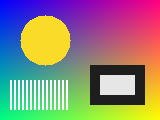
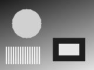
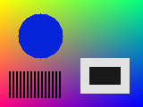
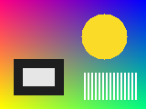
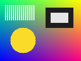
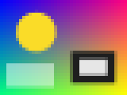
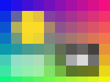
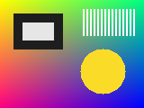

# COP 3410 – Assignment 3: Organizing Information and Recursion

**Author:** Andres Zubizarreta

All code is in [`toolkit.py`](toolkit.py). [`demo.py`](demo.py) runs every
function, runs the experiments from 1.6 and saves every input and output image
to [`examples/`](examples). To use a different image, run
`python demo.py photo.jpg cartoon.png`.

The test images were drawn pixel by pixel in `demo.py`: a colorful "photo" with
smooth gradients, a sun, a framed box and thin white stripes, and a cartoon house
with large flat areas for the paint bucket.

| Photo input | Cartoon input |
| --- | --- |
|  |  |

## Background question

**Why is a pixel a tuple but a row a list?**
A pixel is always exactly three numbers that belong together, so an immutable,
fixed-size tuple fits it and also makes it hashable, which lets us put colors in
sets and use them as dictionary keys in Part 2. A row is a sequence of pixels
whose length depends on the image and whose entries we need to change (for
example `copy[row][col] = new_color` in the paint bucket), so it needs to be a
mutable list.

## Part 1: Photo filters

### 1.1 Grayscale

Each pixel becomes `(v, v, v)` with `v = round(0.299R + 0.587G + 0.114B)`.

| Input | `grayscale(img)` |
| --- | --- |
|  |  |

### 1.2 Invert

| Input | `invert(img)` |
| --- | --- |
|  |  |

### 1.3 Flip and rotate

| Input | `flip_horizontal` | `flip_vertical` | `rotate_90` |
| --- | --- | --- | --- |
|  |  |  |  |

**Which flip was clearer?** The slicing version of `flip_horizontal`
(`row[::-1]`) was clearer, because one short expression says "reverse the row",
while the loop in `flip_vertical` makes you track a backwards `range` and its
off-by-one end value.

**Where does pixel (row, col) go in `rotate_90`?** For an image with `height`
rows, pixel `(row, col)` moves to `(col, height - 1 - row)`. The first column
read from bottom to top becomes the first row, so the output has `width` rows
and `height` columns (120 × 160 became 160 × 120).

### 1.4 Box blur

| Input | `blur(img)` |
| --- | --- |
|  |  |

### 1.5 Pixelate

| Input | `block = 4` | `block = 8` | `block = 16` |
| --- | --- | --- | --- |
|  |  |  |  |

### 1.6 Experiments and thinking

**Blur 1, 5 and 20 times.**

| 1 time | 5 times | 20 times |
| --- | --- | --- |
|  |  |  |

Each pass makes the image softer: the stripes fade and the edges of the sun and
the box turn into glows, but the image never becomes one solid color. A blur
only averages a pixel with its immediate neighbors, so color spreads just one
pixel per pass and pulls nearby pixels toward each other without erasing
large-scale differences. After 20 passes the top-left corner was still
`(0, 2, 254)` and the bottom-right was still `(254, 252, 4)`. Rounding to whole
numbers also stops tiny changes once neighbors are almost equal. The number of
distinct colors actually went up (14,143 → 16,769), because sharp edges get
replaced by many in-between shades.

**Is `invert(invert(img)) == img` always true? Is
`grayscale(grayscale(img)) == grayscale(img)`?** Both are `True` in code.
Inverting twice gives `255 - (255 - x) = x` exactly with integers.
Grayscale is stable because a gray pixel `(v, v, v)` gives
`(0.299 + 0.587 + 0.114)·v = v`. I also checked every gray level from 0 to 255.

**`rotate_90` four times; `flip_horizontal` then `flip_vertical`.** Rotating four
times is a full 360° turn and gives back the original image (`True`). Flipping
horizontally and then vertically sends `(row, col)` to
`(height - 1 - row, width - 1 - col)`, which is a 180° rotation, exactly the
same as `rotate_90` applied twice (`True`). It is not the same as the original.

| `flip_horizontal` then `flip_vertical` | `rotate_90` twice |
| --- | --- |
|  |  |

## Part 2: Understanding color

### 2.1 How many colors?

`unique_colors(img)` returned 14,143 distinct colors for the photo. On the tiny
2 × 3 example image with red repeated, it returned only 5 colors because the set
keeps each color once. Putting a list in a set fails with
`TypeError: cannot use 'list' as a set element (unhashable type: 'list')`, because
a list can change, so it cannot have a fixed hash value.

### 2.2 Brightness histogram

`brightness_histogram(img)` puts each pixel in bin `v * bins // 256`.
`print_histogram` scales the bars so the longest one is 50 characters and prints
the count at the end:

```
bin  0 |  0
bin  1 | ################################ 1513
bin  2 | ######### 419
bin  3 | ##################### 979
bin  4 | ######################## 1109
bin  5 | ############################### 1476
bin  6 | ################################### 1649
bin  7 | ########################################### 2023
bin  8 | ########################################## 1963
bin  9 | ############################ 1307
bin 10 | ######################## 1113
bin 11 | ################## 869
bin 12 | ################# 816
bin 13 | ################################################## 2355
bin 14 | ############### 709
bin 15 | ################### 900
```

The tall bin 13 comes from the large yellow sun (`v = 208`), the white stripes
fill bin 15, and bin 0 is empty because no pixel is darker than `v = 16` (even
the dark frame, `(30, 30, 30)`, lands in bin 1).

## Part 3: Paint bucket

`flood_fill` follows the given signature and marks its base cases and recursive
case in comments. `paint_bucket` copies the image, reads the target color at the
starting pixel and starts the fill with an empty `visited` set.

**Why a set for `visited`?** Checking `(row, col) in visited` is a hash lookup
that takes constant time on average with a set, while a list would be scanned
from the start on every call, getting slower as more pixels are filled.

Filling the sky, the house and the grass one after another (tolerance 20):

| Input | Sky filled | + house | + grass |
| --- | --- | --- | --- |
|  |  |  |  |

The fill stops at the sun, roof, windows and door because their colors are more
than 20 away from the target in at least one channel, and the original image was
unchanged after each fill. A large region can need one nested call per pixel,
more than Python's default limit of about 1000, so `paint_bucket` raises the
recursion limit to the number of pixels in the image.
